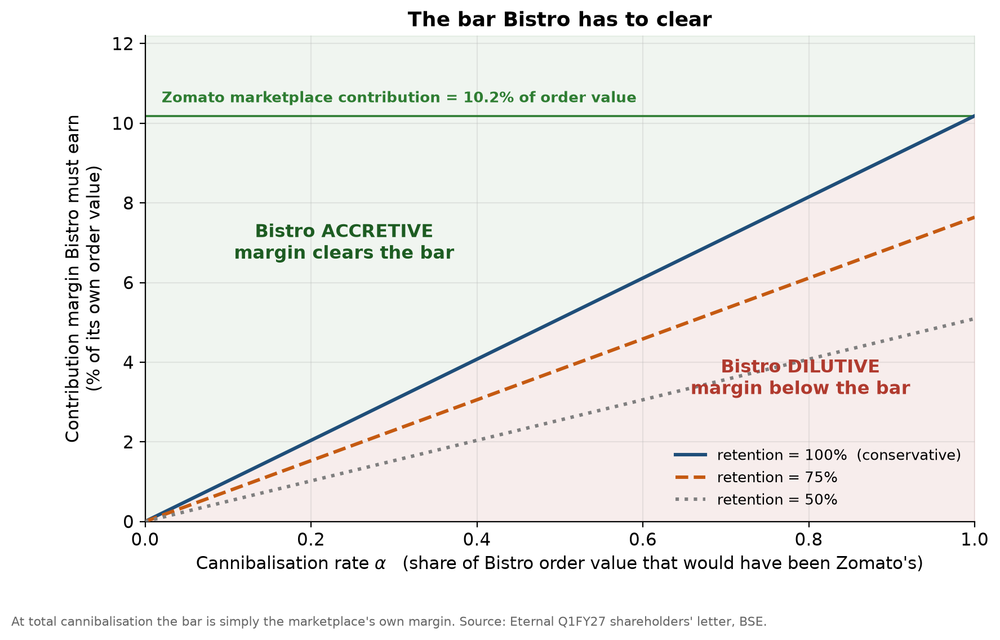

# Food Delivery Pricing & Cannibalisation: Bistro vs Zomato

**A reproducible strategy and unit-economics study of when Blinkit's Bistro
creates—or destroys—value for Eternal's food-delivery portfolio.**

## Executive summary

Eternal operates both **Zomato**, a restaurant marketplace, and **Bistro**,
Blinkit's 10-minute cooked-food service. Because public disclosures do not
reveal user- or city-level switching, the true cannibalisation rate cannot be
estimated credibly. I therefore reframed the problem as a **switching-value
analysis**:

> At what cannibalisation rate does Bistro stop creating value for Eternal?

| Question | Answer |
|---|---|
| Break-even economics | At 100% cannibalisation, Bistro must earn a contribution margin above **10.2%** of order value—the disclosed Zomato food-delivery margin. |
| More realistic scenario | At 60% cannibalisation, Bistro's required margin falls to **6.1%**. |
| Current materiality | The entire segment containing Bistro is only **0.88% of food-delivery NOV**; cannibalisation is not yet a material P&L risk. |
| Observed price position | Across matched dishes, Bistro is **18.6% cheaper** than marketplace alternatives. |
| Decision implication | The threshold matters for Bistro's **scale-up decision**, not its current financial impact. |



## What I built

- A unit-economics switching-value model that separates incremental demand,
  cannibalised demand and competitor leakage.
- A reproducible quarterly panel built from Eternal and Swiggy disclosures,
  with validation gates around accounting-definition changes.
- A hand-collected menu-price study covering **225 quotes across 28 matched
  dishes**, estimated with item fixed effects and cluster-aware inference.
- Seven pre-specified business hypotheses with explicit kill conditions.
- Tested Python analysis modules, seven narrative notebooks and a self-contained
  six-slide board deck.

**Core tools:** Python, pandas, NumPy, SciPy, statsmodels, Matplotlib, Jupyter,
pytest, fixed-effects modelling and sensitivity analysis.

This project is designed to show both commercial judgement and analytical
discipline: when the desired causal estimate is not identifiable, it replaces
false precision with a decision-relevant threshold and makes every assumption
auditable.

## The model

```
CM_net = CM_bistro - (alpha * retention * CM_zomato)
alpha* = CM_bistro / (retention * CM_zomato)
```

| Term | Meaning |
|---|---|
| `alpha` | Share of Bistro **order value** that would otherwise have been Zomato food delivery order value |
| `retention` | Share of that Eternal would actually have kept, given Swiggy Bolt, Snacc, Zepto Cafe, Toing and Ownly |
| `CM_bistro` | Bistro contribution margin, % of its own order value |
| `CM_zomato` | Zomato food delivery contribution margin, % of NOV. **Disclosed: 10.19%** |

Alpha is measured on order value rather than on orders because Eternal has never
disclosed food delivery Orders or AOV, while it does disclose Contribution
against NOV. That is a forced choice and the direction it biases the answer is
recorded in [`docs/ASSUMPTIONS.md`](docs/ASSUMPTIONS.md).

**`CM_zomato` is read, not assumed.** Eternal publishes food delivery
Contribution every quarter and publishes its definition: Adjusted Revenue less
last mile delivery, platform funded discounts, payment gateway, support, refunds
and delivery partner onboarding. Every line moves with order volume, so it is
already the marginal cost base a switching value needs. No fixed cost add back
is required, which removes what the brief expected to be one of its five load
bearing assumptions.

**`CM_bistro` is not estimated.** Bistro has no standalone P&L and menu prices
have not been sampled. Rather than guess it and dress the guess in a sensitivity
range, the analysis inverts the threshold and reports the bar Bistro has to
clear.

**A cannibalised order is not a loss.** It is an order that migrated between
business models. On Zomato, Eternal is a platform operator and takes a slice of
a large order. On Bistro it is a dealer and takes all of a small order, less the
cost of producing it. There is no arithmetic reason those must differ, which is
exactly why the threshold is worth computing rather than asserting.

Inverted, the same equation gives the bar: `required CM_bistro = alpha *
retention * CM_zomato`. At `alpha = 1` and `retention = 1` it collapses to
`CM_bistro > CM_zomato`. Under total cannibalisation the whole question is
simply whether an owned kitchen earns more per rupee of order value than the
marketplace does.

**Retention matters.** The naive version assumes a cannibalised order would have
earned Eternal `CM_zomato`. If the order was leaving for Swiggy Bolt anyway,
Eternal forfeits nothing by serving it from its own kitchen. Setting
`retention = 1` recovers the naive version, so the number it produces is a
conservative floor on the true threshold.

---

## Start here

| If you have | Read |
|---|---|
| 2 minutes | This README and the chart above |
| 15 minutes | **[The six slide board deck](output/bistro_board_deck.html)** — the deliverable. Open it in a browser. |
| 30 minutes | [`docs/FINDINGS.md`](docs/FINDINGS.md), every hypothesis against its kill condition |
| Longer | Notebooks 00 to 06, in order |

---

## The companion study: does Bistro actually undercut Zomato?

The switching value above reports a threshold. It does not say where the real
cannibalisation rate sits, because that depends on how far the two price ranges
overlap, and no filing reports that.

So a second study went and measured it. 355 screenshots collected by hand from
Bistro, Zomato and Swiggy in Delhi, matched dish by dish, giving 225 price
quotes across 28 dishes.

**[`notebooks/07_menu_price_study.ipynb`](notebooks/07_menu_price_study.ipynb)**
is the full walkthrough and it renders on GitHub with every output in place.

| | |
|---|---|
| Headline | The same dish costs **18.6% less** on Bistro |
| Assumption free check | Bistro sits at the **0.29 percentile** of each dish's marketplace price distribution against a null of 0.50, Wilcoxon p = 0.0019 |
| At checkout | Fees widen the gap to about a half. A typical restaurant coupon pulls it back to about a third. The best coupon on the platform can close it |
| Method | Item fixed effects, errors clustered by dish, wild cluster bootstrap because 28 clusters is too few for asymptotics |
| Written up | Full specification and outputs are documented in [`notebooks/07_menu_price_study.ipynb`](notebooks/07_menu_price_study.ipynb). |

The specification is not asserted in that study. It is derived from ten
diagnostic gates, each of which reads a test statistic and decides the next
step, and two of them changed the answer rather than confirming it.

The study measures the price gap **where the two services compete**. It cannot
measure how much of the marketplace they compete for, because the sampling frame
is Bistro's own menu. That limit is stated rather than argued around.

---

## Method

Seven hypotheses, each with a **kill condition written before the analysis ran**.
None was adjusted afterwards.

| # | Hypothesis | Kill condition | Verdict |
|---|---|---|---|
| H1 | Cannibalisation is margin accretive, `alpha* > 1` | `alpha*` falls below 1 at `retention = 1`, and below the plausible range for actual alpha | Threshold computed, comparison open |
| H2 | Bistro is defensive, so `retention < 1` | Bistro launched first, into cities with no competitor presence | Not killed, partly evidenced |
| H3 | Price points separate, bounding alpha from above | The price distributions substantially overlap | **Half killed** by the price study, see below |
| H4 | Observable data is consistent with low to moderate alpha | Per customer value turns persistently negative while MTU stays positive | Survives, see note |
| H5 | Category maturity, not Bistro, explains the growth path | Swiggy food delivery grows materially faster through the scale up | Not killed, but moot |
| H6 | The real conflict is capital allocation | Food delivery holds steady capex and marketing share | Survives, emphatically |
| H7 | The conflict is already resolved organizationally | Food delivery retains independent capital authority | Not yet run |

Food delivery NOV growth **accelerated** from 13.1% to 20.1% YoY straight
through the Bistro scale up, and contribution margin rose from 9.9% to 10.2% of
NOV. Meanwhile food delivery's share of B2C net order value fell from 63% to
35% as Blinkit went from 526 to 2,443 stores. Bistro went from 38 to about 45
kitchens in the same window. Full detail in [`docs/FINDINGS.md`](docs/FINDINGS.md).

H1 is the headline. H2 and H3 bound its two uncertain parameters. H4 and H5 are
supporting evidence. H6 and H7 are the strategy argument that follows if H1
holds.

**H3 was rested on management's own words and now has data against it.** The
original evidence was Eternal saying Bistro targets "INR 50-150 price points",
which is an assertion and not a measurement. The
[price study](notebooks/07_menu_price_study.ipynb) measured it, and the verdict
splits in two.

* **Separation at the top is real.** Bistro's dearest item anywhere is ₹259.
  Marketplace quotes for the same dishes reach ₹683 and the full catalogue goes
  far past that. Orders above the ceiling cannot be cannibalised at all, which
  is what H3 needed and it holds.
* **Separation inside that band is not.** Below the ceiling the two
  distributions overlap heavily, and on matched dishes Bistro is 18.6% cheaper
  rather than occupying a different band. That is the half the kill condition
  catches.

The practical reading is that `alpha` is bounded above by the ceiling and is not
small inside it. Cannibalisation is partial because Bistro cannot reach the
expensive half of the market, not because it serves a different customer in the
half it can reach.

**Core technique for H4.** Eternal has never disclosed food delivery Orders or
AOV, so order frequency cannot be solved for and the planned three way split is
not executable. The honest substitute is a two way log space split of NOV into
transacting customers and NOV per transacting customer, which carries frequency
and ticket size together. Contributions sum exactly by construction.

**Control group for H5.** Swiggy food delivery. Swiggy has no Bistro, so a
parallel slowdown points to category maturity rather than internal substitution.
Swiggy is contaminated: it runs Bolt and Snacc. The notebook states the
direction that biases the comparison.

---

## Repo layout

```
src/            analysis library: config, ingest, panel, metrics, unit_economics, viz
notebooks/      the narrative, in order 00 to 06
data/processed/ the quarterly panel (committed, so results are reproducible)
data/manual/    hand entered timelines, menu sample, and the CM_bistro stack
output/          the board deck (bistro_board_deck.html) and generated figures
output/tables/  generated tables for the deck
docs/           assumptions log and findings
tests/          unit tests for every number the deck rests on
```

Logic lives in `src/`, notebooks import it. That separation means a number can
be unit tested, and re-running a notebook cannot quietly change a result that
already went into the write up.

`src/unit_economics.py` carries the switching value. It is one division and it
is the number the entire recommendation turns on, so it is tested rather than
typed into a cell.

---

## Reproducing

```bash
pip install -r requirements.txt
pytest -q
```

**The panel is committed and the analysis runs.** Sixteen quarters, Q3FY23 to
Q1FY27, from Eternal's shareholders' letters filed with BSE, plus five quarters
of Swiggy as a control. Every row carries the letter it came from.

Eternal's Annexure A tables are vector graphics, so `pdftotext` returns nothing
from them. The panel was transcribed from rendered page images and then checked
three ways: overlapping quarters across three letters match exactly, quick
commerce `NOV / Orders` reproduces the disclosed net AOV to within 2%, and the
validation gate holds any implausible move until it is explained in writing.

```bash
jupyter lab notebooks/
```

Run `00_data_and_validation.ipynb` first. It builds the panel and refuses to
let the analysis notebooks run until every validation breach has been reviewed.
Then run `01_unit_economics.ipynb`. Every other notebook serves it.

---

## Data integrity

Blinkit moved to an inventory led (1P) accounting model, which books full order
value as revenue rather than commission. Reported revenue jumped with no
matching change in Net Order Value.

A parser that reads `revenue` across that break produces growth charts that are
wrong and entirely plausible looking. Two safeguards.

1. **NOV, never revenue,** for any growth comparison spanning the break.
2. **A validation gate.** Every quarter on quarter move outside a plausible band
   is written to a review queue. `panel.assert_reviewed()` at the top of each
   analysis notebook refuses to run until each breach carries a written
   explanation in [`docs/ASSUMPTIONS.md`](docs/ASSUMPTIONS.md).

---

## What the per order model leaves out

Every model omits something. Naming the omissions and their direction is worth
more than another decimal place, so they go here rather than in a footnote.

| Omission | Direction |
|---|---|
| A Bistro order adds nothing to restaurant selection, which is the moat | Against Bistro |
| A dealer exerts market power on both sides and tends to support lower volume than a platform operator | Against Bistro |
| Owning kitchens weakens restaurant bargaining power over Eternal | For Bistro |
| The model compares orders, not lifetimes. Frequency and retention may differ between the two products | Unknown |

---

## Limitations

Stated upfront rather than buried, because they bound what the findings can
claim.

1. No city level or user level data is public. A true difference in differences
   is not possible. All findings are circumstantial.
2. Bistro is not broken out separately in the filings. Its effect is inferred
   from the quick commerce aggregate.
3. Swiggy is a contaminated control. It operates Bolt and Snacc.
4. Kitchen counts come from press reports, not filings, and are approximate.
5. Menu prices are hand sampled, not scraped. The sampling frame is documented
   in `02_price_positioning.ipynb`.
6. Roughly ten quarters of data. No statistical power for formal testing. All
   comparisons are descriptive.
7. `CM_bistro` is built from benchmarks rather than disclosure. It is the
   weakest number in the project. Confidence is stated separately for it and
   for `CM_zomato`, which comes from filings.

---

## Sources

Eternal Ltd quarterly shareholder letters and investor presentations, BSE
corporate announcements (scrip 543320), Swiggy quarterly filings, earnings call
transcripts. Every row in the panel carries a `source_url`.

---

_Independent analysis using public filings. Not investment advice. No
affiliation with Eternal Ltd, Blinkit, Zomato or Swiggy._
